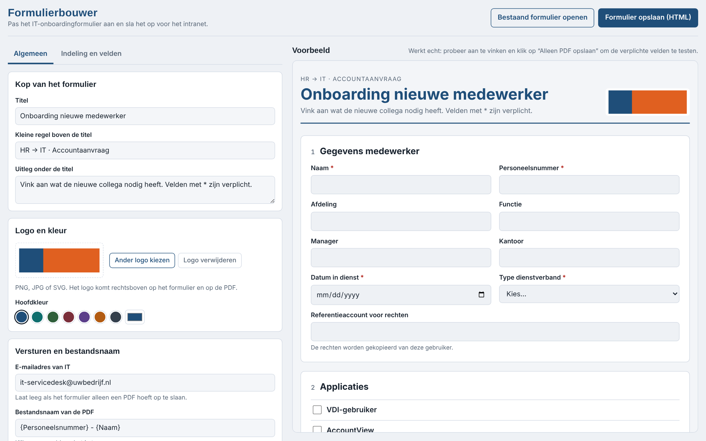
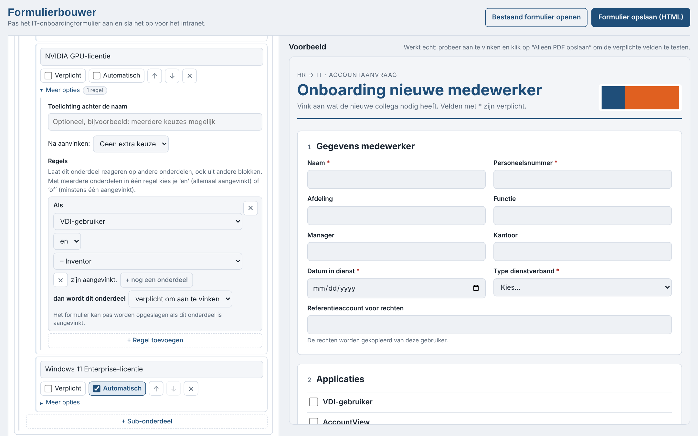
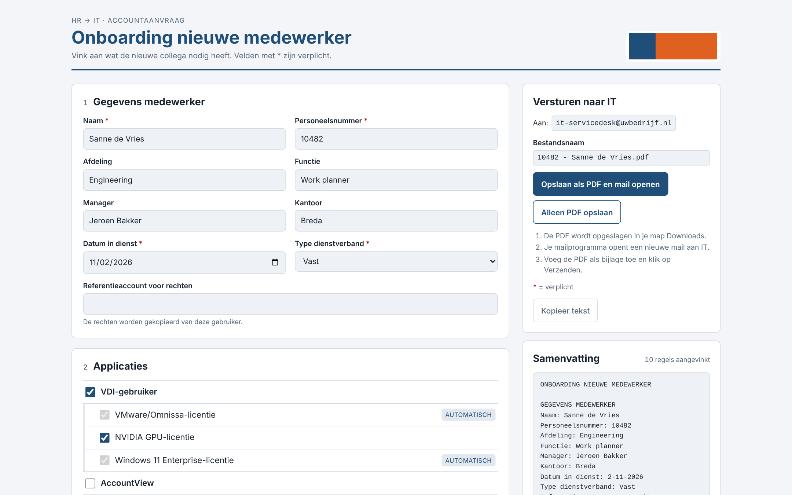
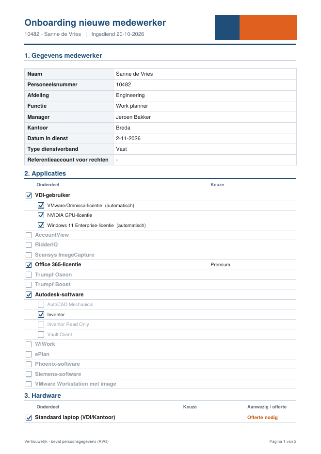

# Formulierbouwer – IT Onboarding Form Builder

A no-code tool for building and maintaining an **IT onboarding request form**: the form HR fills in when a new employee starts, so IT knows which accounts, applications and hardware to prepare.

The builder is a single HTML file. Open it in a browser, adjust the form with clicks instead of code, and save the result as a standalone HTML form for your intranet or SharePoint. No server, database or installation needed.

> The user interface is in Dutch. This README explains the tool in English.



---

## Contents

- [Why this tool](#why-this-tool)
- [How it works](#how-it-works)
- [Getting started](#getting-started)
- [Building a form](#building-a-form)
- [Rules](#rules)
- [The finished form](#the-finished-form)
- [Files in this repository](#files-in-this-repository)
- [Privacy and data](#privacy-and-data)
- [Limitations](#limitations)
- [Technical notes](#technical-notes)
- [Credits](#credits)

---

## Why this tool

Onboarding requests often arrive by email in different formats: some say "same as Peter", some are missing the start date, and almost none say whether a laptop is already in stock. This tool fixes that with:

- **One fixed format** that HR fills in by clicking, with as little typing as possible.
- **Built-in logic.** For example, choosing *VDI user* automatically adds the VMware/Omnissa and Windows 11 Enterprise licences.
- **Required fields**, so a request cannot be submitted half-finished.
- **A clear PDF** with a predictable file name (`10482 - Sanne de Vries.pdf`) that IT can file and process.
- **A builder** so someone without technical knowledge can keep the form up to date when applications or hardware change.

## How it works

```
┌────────────────────────┐      save as HTML      ┌──────────────────────────┐
│  formulierbouwer.html  │ ─────────────────────▶ │  Onboarding form (.html) │
│  (the builder)         │ ◀───────────────────── │  on intranet/SharePoint  │
└────────────────────────┘    open to edit again  └────────────┬─────────────┘
                                                               │ HR fills in
                                                               ▼
                                              ┌──────────────────────────────────┐
                                              │ PDF "Employee number - Name.pdf" │
                                              │ + pre-filled email to IT         │
                                              └──────────────────────────────────┘
```

1. **IT or an administrator** uses the builder to set up the form: fields, applications, hardware, rules, logo and colour.
2. The builder **saves a standalone HTML form**. The full form configuration is stored inside that file.
3. **HR opens the form**, fills it in and clicks *Opslaan als PDF en mail openen* (Save as PDF and open email).
4. The PDF is saved and an email to the IT address opens with the subject and a short summary already filled in. HR attaches the PDF and sends it.
5. To change the form later, open the saved HTML file in the builder again (*Bestaand formulier openen*), edit it and save.

## Getting started

1. Download `formulierbouwer.html` and open it in a modern browser (Edge, Chrome or Firefox).
2. The builder starts with a complete example onboarding form. Adjust it to your organisation.
3. Click **Formulier opslaan (HTML)** to save the form.
4. Put the saved HTML file somewhere HR can open it, such as a SharePoint library, an intranet page or a shared folder.

Your work in the builder is saved automatically in your browser, so you can close it and continue later. To move the work to another computer or colleague, use the saved HTML form: it contains everything.

## Building a form

The builder has two tabs. Every change shows up immediately in the live preview on the right, and the preview works like the real form, including required fields and PDF export.

### Tab "Algemeen" (General)

| Setting | What it does |
|---|---|
| **Title, eyebrow, intro** | The heading text at the top of the form. |
| **Logo** | Upload a PNG, JPG or SVG. It appears on the form and on the PDF. |
| **Main colour** | Pick a preset or any colour. Used for headings, buttons and the PDF. Dark mode is supported. |
| **IT email address** | Where the email goes. Leave it empty if the form should only save a PDF. |
| **PDF file name** | A pattern built from field names, for example `{Personeelsnummer} - {Naam}`. Click a field chip to insert it; a live example shows the result. If you rename a field, the pattern updates with it. |
| **Email subject** | Same pattern system as the file name. |
| **PDF footer** | Small text at the bottom of each PDF page, for example a confidentiality notice. |
| **Extra column** | Name and options of the optional status column used in checklists, by default *Al aanwezig / Offerte nodig* (in stock / quote needed). |

### Tab "Indeling en velden" (Layout and fields)

A form is made of **blocks**, and there are two kinds:

- **Field blocks (Invulvelden)** hold input fields for things like name, employee number and start date. Field types:
  - text
  - date
  - dropdown, with your own options
  - large text area
- **Checklist blocks (Vinklijst)** hold items to tick, such as applications, hardware or security.

Everything can be added, renamed, reordered (↑ ↓) and deleted. If you delete something by mistake, **Ongedaan maken** (Undo) brings it back.

**Options per field**
- **Verplicht** (required): the form cannot be saved while this field is empty.
- **Toelichting** (hint): small help text under the field.
- **Over de hele breedte** (full width): the field spans both columns.
- **Tonen** (show): only show this field when another dropdown field has a specific value. Example: *End of contract* only appears when the contract type is *Temporary*, *Intern* or *Contractor*.

**Options per checklist item**
- **Verplicht aanvinken** (must be ticked).
- **Na aanvinken** (after ticking): ask for an extra choice from a list, such as a licence type, or a quantity, such as the number of monitors. The choice itself can be made required.
- **Sub-items** that only appear once the main item is ticked. A sub-item can be set to **Automatisch**, which means it is ticked together with its parent.
- **Rules**: see below.

**Options per checklist block**
- Show the extra status column (*in stock / quote needed*) and optionally make it required.



## Rules

Rules make items react to other items, including items in other blocks: an application can depend on hardware, and the other way round.

Each rule reads like a sentence:

> **If** [item] (**and** / **or** [item] …) is ticked, **then this item is** [action].

### Conditions

- One or more items from any checklist block. Sub-items are shown indented in the dropdown.
- **en** (and): all selected items must be ticked.
- **of** (or): at least one of the selected items must be ticked.
- For combinations such as *(A and B) or C*, add two rules. An item reacts as soon as any of its rules applies.

### Actions

| Action | What happens in the form | Label shown |
|---|---|---|
| **automatisch aangevinkt** (automatically ticked) | The item is ticked and locked. It unticks again when the condition no longer applies. | *Automatisch* |
| **verplicht om aan te vinken** (required) | The form cannot be saved until HR ticks this item. | *Verplicht bij …* (required with …) |
| **niet aan te vinken** (blocked) | The item is unticked, greyed out and cannot be ticked. Its sub-items disappear. | *Niet mogelijk bij …* (not possible with …) |
| **vastgezet op keuze** (fixed choice) | Only for items with a dropdown. HR can still tick the item freely, but once it is ticked the choice is locked to the set value. | *Vast bij …* (fixed with …) |

### Examples from the default form

- *VDI user* → *VMware/Omnissa licence* and *Windows 11 Enterprise licence* are ticked automatically (sub-items set to *Automatisch*).
- **If** *VDI user* is ticked → *Office 365 licence* is fixed to **Premium**.
- **If** *VDI user* **and** *Inventor* are ticked → *NVIDIA GPU licence* is required.

More examples of what you can set up:

- **If** *Trumpf Oseon* **or** *Trumpf Boost* is ticked → *WiWork* is ticked automatically.
- **If** *VDI user* is ticked → *VMware Workstation with image* cannot be ticked.

The builder prevents rules that would lock each other, such as A ticked automatically by B while B is ticked automatically by A. Items that would create such a loop are not offered in the dropdown.

## The finished form



**What HR sees:**
- Required fields are marked with a red *.
- Automatic, fixed, required and blocked items carry a small label explaining why.
- A live **summary** on the right lists everything that has been selected.
- When HR clicks save with something missing, a list of the open points appears. Clicking a point jumps to the field.
- **Opslaan als PDF en mail openen** (Save as PDF and open email) saves the PDF and opens an email to IT.
- **Alleen PDF opslaan** (Save PDF only) is for the employee file.
- **Kopieer tekst** (Copy text) copies the summary as plain text, as a fallback.

**The PDF**



- The logo and title at the top, with the file name and submission date.
- Every block in order. Unticked items are shown in grey, so IT can also see what was deliberately not requested.
- The status column in colour: green for the first option (*in stock*), orange for the others (*quote needed*).
- The footer text and page numbers on every page.

## Files in this repository

```
formulierbouwer.html                   The builder (open this to create or edit forms)
examples/
  Onboarding nieuwe medewerker.html    Example form saved with the builder
docs/
  builder-general.png                  Screenshots used in this README
  builder-rules.png
  form.png
  pdf.png
README.md
```

## Privacy and data

- **Everything runs in the browser.** The builder and the forms send no data to a server.
- **Builder drafts** are stored in the browser's local storage on the computer where you use the builder.
- **The logo** is embedded in the saved form file as an image. It is not loaded from anywhere.
- **Filled-in forms** exist only as the PDF the user saves and the email they send. Nothing is stored centrally.
- **The PDFs contain personal data**, so store and delete them according to your organisation's GDPR/AVG retention policy. The default PDF footer says so.

## Limitations

- **The PDF is not attached to the email automatically.** Browsers do not let a web page add attachments to an email, so the form saves the PDF and opens a pre-filled email, and the user attaches the PDF. Fully automatic submission needs a back end, such as Microsoft Forms with Power Automate, or a small web service.
- **The PDF export needs internet access** to load the jsPDF library from `cdnjs.cloudflare.com`. If that domain is blocked, the form shows a message and saving the PDF fails. To work offline, download `jspdf.umd.min.js` and change the `<script src>` in the saved form to a local path.
- **The email button** uses a `mailto:` link, so it needs a default mail client such as Outlook.
- **The interface language is Dutch.** All labels in the form itself (titles, field names, options) are fully configurable. The fixed texts, such as button labels, live in the code.

## Technical notes

For developers who want to extend the tool:

- **No build step and no dependencies to install.** Everything is plain HTML, CSS and JavaScript in one file. The only external script is [jsPDF 2.5.1](https://github.com/parallax/jsPDF), loaded from cdnjs. The builder also loads IBM Plex fonts from Google Fonts; the saved forms use system fonts.
- **Same code in builder and form.** The builder contains the form runtime in a `<script id="runtime">` block and the form styles in `<style id="form-css">`. When you save a form, those two blocks are copied into the new HTML file together with the configuration. The preview and the saved form therefore always run the same code.
- **Configuration** is a JSON object stored in the saved form as `<script id="form-config" type="application/json">`. In outline:

  ```js
  {
    title, eyebrow, intro, itEmail, logo, accent,
    fileName: "{Personeelsnummer} - {Naam}",
    mailSubject, footer, statusLabel, statusOptions: [...],
    blocks: [
      { type: "fields", title, fields: [
          { id, label, type: "text" | "date" | "select" | "textarea",
            options, required, hint, full,
            showIf: { field, values: [...] } } ] },
      { type: "checklist", title, note, status, statusRequired, items: [
          { id, label, hint, required,
            choice: "" | "list" | "count", options, choiceRequired,
            rules: [ { action: "auto" | "required" | "blocked" | "value",
                       mode: "all" | "any", when: [itemId, ...], value } ],
            subs: [ /* same shape, plus auto: true */ ] } ] }
    ]
  }
  ```

- **Older configurations** that used the earlier `autoWhen` and `fixed` settings are converted to `rules` automatically when they are opened.
- **Styling** of the generated form is scoped under the `.obf` class and uses CSS custom properties. Light and dark mode both work, and container queries make the layout responsive inside the builder's preview pane.

## Credits

Designed by Antoine Troost.

Every builder page and every form saved with it shows a small credit line, *"Designed by Antoine Troost - [current year]"*. The year updates automatically. The credit is part of the form runtime and is not intended to be removed.

<!-- Add a LICENSE file and mention the licence here if you publish this repository. -->
